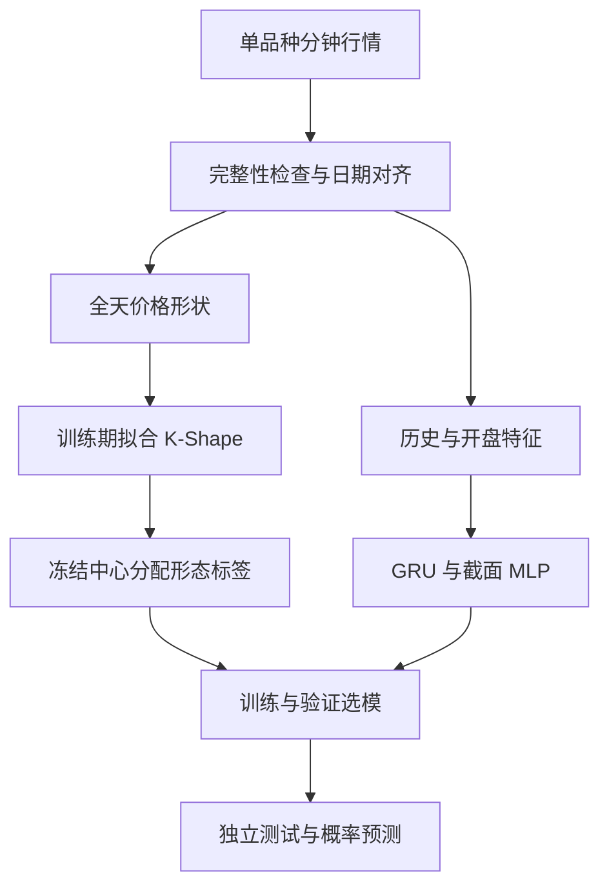

# 股指期货日内形态识别与预测

**K-Shape 聚类 · GRU 时序编码 · 25 维截面特征 · 按时间划分的实验流程**

项目研究如何把股指期货日内价格路径归纳为形态标签，并在开盘后利用已观测信息预测当天所属形态。

本仓库包含模块化的数据处理、形态聚类、模型训练和预测流程，以及早期实验脚本存档。**当前公开演示使用模拟数据，尚未验证真实市场预测表现。** 仓库不附真实行情、预生成特征或预训练权重。

## 研究问题与方法

1. 将每个完整交易日的 240 根一分钟收盘价做逐日 z-score 标准化。
2. 仅用训练期样本拟合 K-Shape，以上行、下行和正弦震荡曲线初始化三类中心；验证期、测试期通过冻结的中心分配标签。
3. 用前一交易日最后 230 根 K 线与当天最初 10 根 K 线组成 `240 × 6` 输入，用另外 25 个开盘与历史统计因子描述市场状态。
4. 双层 GRU 与截面 MLP 分别编码后融合，输出三类概率；另有纯 GRU、纯 MLP 的消融实验入口。



形态编号是与初始化原型的匹配结果，需要人工审查训练后中心图。初始化不保证经济含义，类别 2 也不能自动等同于“适合均值回归交易”。本项目预测全天形态，标签包含已经观测的开盘 10 分钟，属于**早期形态分类**，不能直接解释成未来收益预测。

## 快速运行

建议 Python 3.11。以下命令适用于仓库根目录，命令行参数均为跨平台写法。

```bash
python -m venv .venv
```

Windows PowerShell 激活：`.\.venv\Scripts\Activate.ps1`；macOS/Linux 激活：`source .venv/bin/activate`。

```bash
python -m pip install -e .
python -m unittest discover -s tests -v
intraday-patterns demo-data --output runs/demo_bars.csv
intraday-patterns run --input runs/demo_bars.csv --output runs/demo --train-end 2024-03-11 --val-end 2024-04-01 --epochs 2 --batch-size 16 --cluster-iter 10 --synthetic
```

`runs/demo` 必须尚不存在，以防覆盖实验。重复运行请更换输出目录。2 轮训练、10 次聚类迭代仅用于演示，正式实验默认最多 100 轮并按验证损失早停。

输出包括：数据质量审计、日期标签与划分、训练中心图、训练历史、测试概率、分类指标、多数类基准、配置、依赖版本和模型检查点。测试结果只在验证选模完成后计算。

## 接入自己的数据

输入一个品种的 CSV 或 Parquet，需包含：

```text
trade_time,symbol,open,high,low,close,volume,amount
```

例如将 IC 数据放入 `data/raw/IC.csv`，根据实际日期范围设置训练与验证截止日：

```bash
intraday-patterns run --input data/raw/IC.csv --output runs/ic_hybrid --train-end 2020-12-31 --val-end 2022-12-31 --model hybrid
```

这里的日期是示例，不是对原始数据范围的确认。IH、IF、IC、IM 分别运行，并根据各自真实可用时间选择划分；不要将某品种尚未上市时的数据当成真实期货行情。可用 `--model gru` 或 `--model mlp`，保持同一数据、划分与随机种子进行对照。不要基于测试集挑选模型。

输入时间戳为上海本地时间、不带时区，默认按分钟开始标记；如果数据以分钟结束标记，传入 `--bar-label end`。完整要求、清洗政策及 25 维定义见 [数据说明](docs/DATA.md)。

## 保存后预测

```bash
intraday-patterns predict --checkpoint runs/ic_hybrid/model.pt --history data/raw/history_20days.csv --opening data/raw/today_open10.csv --output runs/today_prediction.json
```

`history` 包含同品种恰好 20 个完整的前序交易日；`opening` 包含当天最初 10 根完整 K 线，字段与训练一致。按开始标记即 09:30–09:39，需等待 09:40 后才能使用。预测不需要当天后续价格。历史日期是否连续，应按交易所日历在上游核验。

## 项目结构

| 路径 | 内容 |
| --- | --- |
| `src/intraday_patterns/data.py` | 行情校验、交易时段、因果特征与日期划分 |
| `src/intraday_patterns/clustering.py` | 训练期 K-Shape、类别原型匹配 |
| `src/intraday_patterns/model.py` | 混合网络及 GRU/MLP 消融版本 |
| `src/intraday_patterns/experiment.py` | 训练、早停、独立测试及模型保存 |
| `src/intraday_patterns/inference.py` | 复用训练特征逻辑的预测入口 |
| `src/intraday_patterns/demo.py` | 可重复的模拟数据生成器 |
| `archive/` | 去除本机路径后的研究脚本存档及文件对应表 |
| `docs/IMPLEMENTATION_NOTES.md` | 实现约定、研究边界及待验证事项 |
| `docs/DATA.md` | 字段、特征公式、信息可用时点 |
| `docs/RESULTS.md` | 模拟演示结果与验证状态 |
| `docs/GITHUB_GUIDE.md` | 上传 GitHub 的操作步骤 |
| `tests/` | 信息泄露、日期对齐、时间戳与模型保存检查 |
| `.github/workflows/checks.yml` | GitHub 自动检查配置 |

## 结果与边界

当前已完成模拟数据上的流程验证，真实行情表现仍待独立实验。实现约定和待验证事项见 [实现说明](docs/IMPLEMENTATION_NOTES.md)。

评价需同时考虑多数类基准、宏平均 F1、平衡准确率和混淆矩阵。高于三分类均匀随机的 1/3 并不自动意味着优于多数类或具有统计显著性。项目尚无包含手续费、滑点、换月与成交约束的交易回测，分类准确率不能替代盈利能力验证。

## 来源与许可

早期实验脚本见 `archive/README.md`。当前实现包含特征构建、训练期内聚类、独立测试与预测流程；具体约定均在文档中说明。

使用 [tslearn KShape](https://tslearn.readthedocs.io/en/stable/gen_modules/clustering/tslearn.clustering.KShape.html)、[PyTorch](https://pytorch.org/docs/stable/index.html)、pandas、NumPy、scikit-learn 等工具。上游依赖遵循各自许可。

本项目代码采用 MIT 许可证，详见 [LICENSE](LICENSE)。上游依赖遵循各自许可证，外部数据遵循其供应商的授权条款。更多信息见[许可说明](docs/LICENSING.md)。仓库不附真实行情、供应商账号或密钥。
