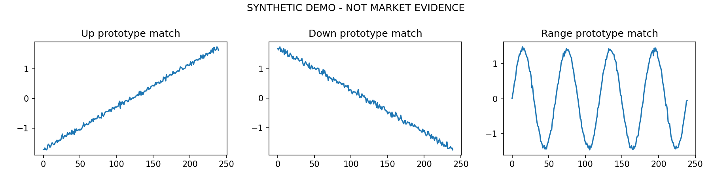

# 结果来源与验证状态

## 本次本地软件验证

- 8 项自动检查通过：特征维度及日期划分、未来分钟不能改变当前特征、不跨越拒绝日、拒绝重复时间、开始/结束时间标记等价、训练/预测特征一致、三种网络检查点重载一致、SBD 标签分配不受预测批量大小影响。
- 使用 90 个模拟工作日生成 21,600 根分钟 K 线；20 日暖机后共 70 个监督样本，训练/验证/测试分别 30/15/25。
- K-Shape 完成训练期拟合和后续标签分配；混合网络训练 2 轮并完成最终测试，属于软件连通性验证。
- 保存后的检查点通过独立预测命令重载，同一日的输出概率与测试批量预测一致；Python wheel 构建成功。
- 本地运行环境：Python 3.13.11、PyTorch 2.9.1 CPU、tslearn 0.7.0。确切版本在 `examples/synthetic_demo/environment.json`，可选版本约束在 `requirements-tested.txt`。GitHub CI 尚未实际执行。

修正标签分配后，模拟演示测试准确率 36%，训练多数类基准为 32%，测试类别计数为 8/6/11。这些只是模拟数据上 2 轮训练的数值，没有体现真实市场预测能力或统计显著性；未根据结果筛选随机种子。

本地检查发现 tslearn 0.7.0 的 `KShape.predict` 会在 `_cross_dists` 中复用训练样本范数，预测批量长度不同会导致不可靠的标签。本项目保留其 K-Shape 训练，但用逐样本全线性归一化互相关（SBD = 1 - max NCC）独立完成冻结中心分配，避免旧范数影响。添加批量不变性检查后重新运行演示，当前示例文件均来自修正后的版本。

`balanced_accuracy` 按 scikit-learn 对该评估集合实际出现的真实类别计算；`macro_f1` 固定对三类计算，缺失类计零。因此缺失类场景下两者采用的类别分母不同，结合 `class_counts` 和混淆矩阵解读。

模拟数据曲线只是流程样例：

## 待真实数据补齐后

1. 核实数据源、各品种上市后的有效日期、分钟时间戳、成交量单位和换月规则。
2. 核对特征顺序、日期索引与实验划分。
3. 按统一的训练/验证/测试日期运行混合模型、纯 GRU、纯 MLP，与多数类对照。
4. 增加滚动时间窗口、多随机种子与适合时间依赖数据的置信区间；若实现 McNemar，保留逐日期配对输出并说明时间独立假设的限制。
5. 若进一步提出投资收益结论，再开发含手续费、滑点、换月、保证金和成交约束的回测。本仓库尚未实现这些交易模块。
